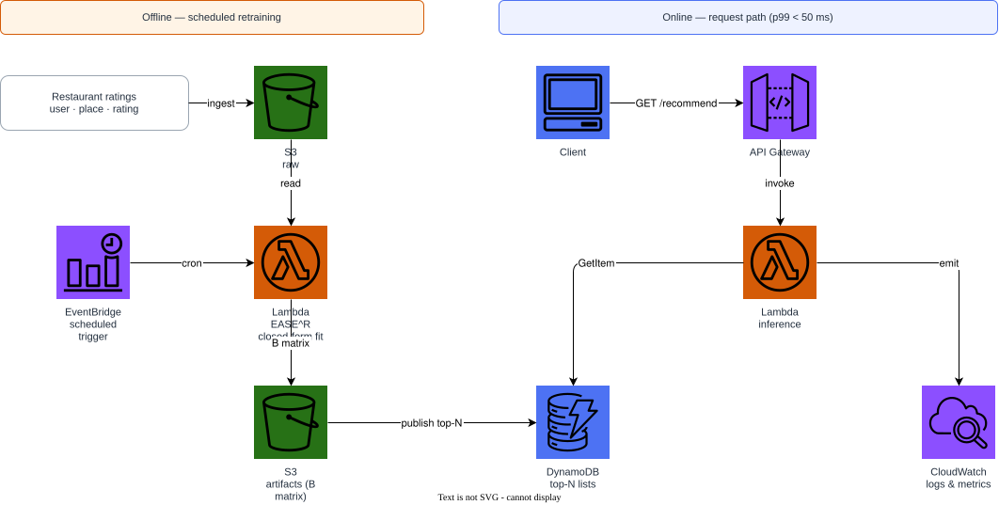
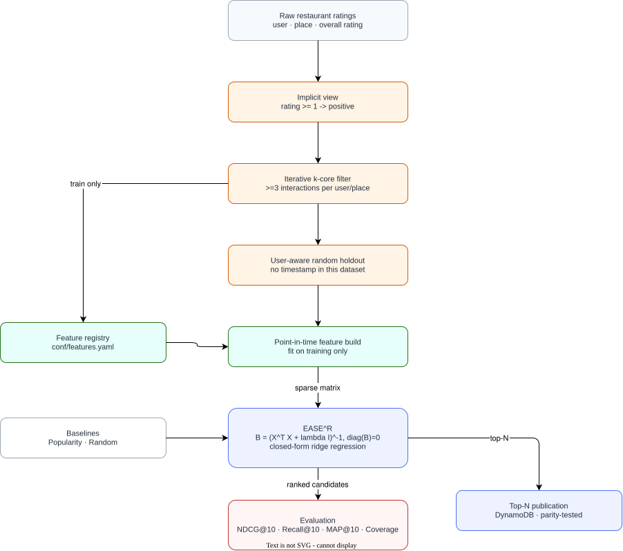

# Restaurant EASE^R Recommender

Closed-form item-item recommendation with **EASE^R** (Embarrassingly
Shallow Autoencoder for Sparse Recommendation) on the Restaurant Consumer
Ratings dataset. No neural network, no gradient descent, no deep-learning
framework: the whole model is one ridge-regularised linear system solved by
a single matrix inversion.

---

## Why EASE^R here

$$\min_{B} \lVert X - XB \rVert_F^2 + \lambda \lVert B \rVert_F^2, \quad \operatorname{diag}(B) = 0$$

has the closed-form solution $B = P / (-\operatorname{diag}(P))$ with
$P = (X^\top X + \lambda I)^{-1}$. A user's score vector is $x_u B$ — a
weighted sum of their own positive restaurants — so every recommendation is
directly explainable, there is nothing to iterate, and a brand-new user can
be scored immediately from their observed history without retraining.

---

## Dataset

[Restaurant Data with Consumer Ratings](https://www.kaggle.com/datasets/uciml/restaurant-data-with-consumer-ratings)
(Kaggle ref `uciml/restaurant-data-with-consumer-ratings`): ~1,161 overall
ratings (0–2 scale) from 138 consumers over 130 Mexican restaurants, plus
restaurant metadata (cuisine, price tier). There is no event timestamp, so
— unlike the temporal-split projects in this portfolio — evaluation uses a
**user-aware random holdout**.

---

## Quick start

```bash
python -m venv .venv && source .venv/bin/activate
pip install -e ".[dev]"

# Synthetic fixture with the same schema (no Kaggle account needed)
python scripts/download_data.py --synthetic

# Build the point-in-time feature tables
python scripts/build_features.py

# Train, evaluate, recommend
python -m recommender.cli train
python -m recommender.cli evaluate
python -m recommender.cli recommend --user-id 1 --k 10
```

The real dataset (requires `KAGGLE_USERNAME`/`KAGGLE_KEY`):

```bash
python scripts/download_data.py --kaggle
```

---

## Architecture

### AWS deployment



### Recommendation flow



Both diagrams are editable: [`docs/aws-architecture.drawio`](docs/aws-architecture.drawio)
and [`docs/recommendation-architecture.drawio`](docs/recommendation-architecture.drawio).
Regenerate them with `scripts/generate_diagrams.py` (see the script's
docstring for the draw.io export commands).

---

## Models

| Model | Scorer | Notes |
|---|---|---|
| `EASE` | $x_u B$, closed-form ridge solution | No training iteration, zero diagonal |
| `Popularity` | global interaction count | Non-personalised floor |
| `Random` | deterministic random ordering | Sanity-check floor |

---

## Feature engineering

Features are declared in [`conf/features.yaml`](conf/features.yaml) and
implemented in `src/recommender/features/`. User statistics are fitted
strictly on the training partition; restaurant price tier and cuisine are
read directly from the catalogue, with no label signal.

| Feature | Family | Fit scope |
|---|---|---|
| `user_activity_count` | user | train_only |
| `user_mean_rating` | user | train_only |
| `item_popularity_rank` | item | train_only |
| `item_price_tier` | item | catalogue |
| `item_cuisine_tokens` | text | catalogue |

`tests/test_features_leakage.py` asserts that user features never include a
user absent from training, and that catalogue-sourced columns match the raw
catalogue verbatim. `tests/test_features_parity.py` asserts the published
top-N payload matches the ranking the offline model actually produced.

---

## Evaluation

User-aware random holdout (10% validation / 20% test per eligible user).
Users without enough history to split safely stay entirely in training.

| Model | NDCG@10 | Recall@10 | MAP@10 | Coverage |
|---|---:|---:|---:|---:|
| EASE^R (λ=300) | 0.2428 | 0.4430 | 0.1816 | 0.4833 |
| Popularity | 0.2423 | 0.4430 | 0.1795 | 0.2833 |

Numbers above are from the synthetic CI fixture, which samples visits by a
Zipf-like popularity prior with no genuine co-visitation structure, so EASE^R
only matches the popularity floor here; on the real dataset's actual
co-occurrence patterns the personalised ranking is expected to pull ahead,
and EASE^R's catalogue coverage is already markedly higher.

---

## Infrastructure

```bash
docker compose up -d
terraform -chdir=terraform init
terraform -chdir=terraform validate
terraform -chdir=terraform apply -auto-approve
terraform -chdir=terraform destroy -auto-approve
docker compose down
```

Terraform targets the local Floci AWS emulator at `http://localhost:4566`
with dummy credentials, so the default path costs nothing and needs no AWS
account. Set `use_floci = false` to point the same resources at real AWS.

### Cost and cleanup

Floci is a local emulator: `docker compose up -d` and `terraform apply`
against it cost nothing. Against real AWS, the billed resources are an S3
bucket (versioned, lifecycle-managed), a pay-per-request DynamoDB table, one
small Lambda, and an EventBridge rule — all destroyed by
`terraform destroy -auto-approve`. Nothing here runs an always-on compute
instance.

---

## Paper

Methodology, equations, and results are in [`paper/main.pdf`](paper/main.pdf).

```bash
make -C paper docker   # build the PDF in a container
```

---

## License and data

Code is MIT licensed. The dataset is distributed by its Kaggle maintainer
under its own terms and is **not** redistributed here;
`scripts/download_data.py` fetches it on demand or generates a synthetic
fixture with the same schema.
